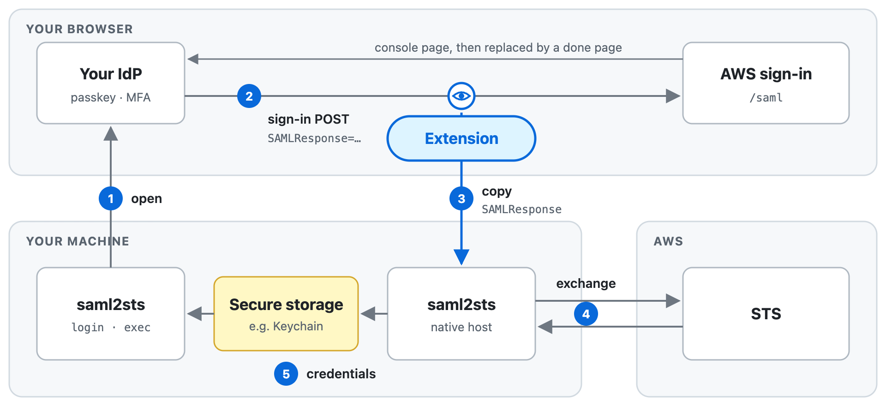

# saml2sts

Get temporary AWS credentials from a SAML sign-in in your own browser.

A browser extension reads the SAML response your IdP posts to AWS on its way there, without stopping it, and hands a copy to saml2sts over [native messaging](https://developer.chrome.com/docs/extensions/develop/concepts/native-messaging), which exchanges it with `sts:AssumeRoleWithSAML`. saml2sts never sees your password, needs no client secret, and works with any IdP that federates with AWS IAM through SAML.

> [!NOTE]
> If you can use AWS IAM Identity Center, use `aws sso login` instead. saml2sts is for organizations that federate IAM roles with SAML directly.

Status: proof of concept. The sign-in machine runs macOS, with a Chromium-based browser or Firefox. A Linux work machine gets credentials through the [agent](docs/agent.md).

## How it works

<picture>
  <source media="(prefers-color-scheme: dark)" srcset="docs/images/flow-dark.png">
  
</picture>

- The CLI and the host never talk to each other directly. They meet only in the OS secure storage, which on macOS lets only the saml2sts binary read what it wrote.
- The SAML response never leaves the host. Only credentials cross into the CLI.
- Your sign-in happens in your everyday browser, so whatever your IdP requires (passkeys, device trust, MFA) just works.

### Sign-in machine and work machine

These docs name the two places involved:

- **Sign-in machine**: runs the browser and signs in to the IdP. The extension, the native messaging host, the secure storage and the IdP session live here, and the SAML response leaves it only for AWS.
- **Work machine**: runs the commands that use AWS, such as `aws` or `terraform`. It receives only short-lived credentials.

Usually one computer is both. They differ when commands run where the browser does not, such as on an SSH host, in WSL, or in a local VM; the [agent](docs/agent.md) serves that case.

## Usage

Tell saml2sts where to sign in, in `~/.config/saml2sts/config.toml`:

```toml
[idp]
url = "https://idp.example.com/..."  # IdP-initiated SSO URL for AWS
duration = "1h"  # optional
region = "ap-northeast-1"  # optional, default us-east-1
sts_endpoint = "https://..."  # optional, e.g. a VPC endpoint; the SAML response is sent here

[roles]  # optional short names
prod-admin = "arn:aws:iam::123456789012:role/admin"
dev = { arn = "arn:aws:iam::123456789012:role/developer", duration = "12h" }  # with its own duration
```

A role's `duration` replaces `[idp] duration` for that role. When STS rejects a duration as longer than the role allows, saml2sts says so and signs in for 1 hour instead.

The native messaging host, which the browser starts, reads this file too, so keep it at this path rather than pointing `SAML2STS_CONFIG` elsewhere. An organization can fix settings in `/Library/Application Support/saml2sts/config.toml`, which wins over this file; see [Running saml2sts in an enterprise](docs/enterprise.md).

Then let saml2sts write an AWS profile for each role your IdP allows, and use them as usual:

```sh
saml2sts profiles sync  # signs in once to read your roles, assuming none of them
aws s3 ls --profile saml2sts-prod-admin  # signs in for that role when it has no credentials yet
```

`profiles sync` writes to `~/.aws/config` a profile per role: `saml2sts-<name>` for roles in `[roles]`, `saml2sts-<account>-<role>` for the rest. It removes those of roles that are gone and leaves everything else in the file alone. Each one names the command to run, not credentials:

```ini
[profile saml2sts-prod-admin]
# managed by saml2sts profiles sync
credential_process = saml2sts creds --role arn:aws:iam::123456789012:role/admin
```

Run `saml2sts profiles sync --refresh` when your roles change, and `--dry-run` to see the changes first.

To keep the profile names your scripts already use, name them in `[profiles]`, by role ARN or a name from `[roles]`:

```toml
[profiles]
dev = "arn:aws:iam::123456789012:role/developer"
prod = "prod-admin"
```

`profiles sync` then writes `[profile dev]` and `[profile prod]` instead of `saml2sts-*` names for those roles. It manages a profile only when it carries the `# managed by saml2sts profiles sync` line, or its name starts with `saml2sts-`, and refuses to replace a profile of the same name that it did not write; remove or rename that one first.

Each sign-in gets credentials for one role only. Besides the profiles:

```sh
saml2sts login  # sign in, then choose a role
saml2sts exec --role prod-admin -- terraform plan  # --role takes an ARN or a name from [roles]
saml2sts roles  # the roles your IdP allows
saml2sts logout --all  # forget every role's credentials and the list of roles
saml2sts doctor  # check the setup without signing in, and say what to fix
```

Credentials are cached per role in the macOS Keychain, never in `~/.aws/credentials`. When they are about to expire, the next `creds` or `exec` opens the browser again; a live IdP session finishes that sign-in without you.

For a work machine that is not the sign-in machine, run the [agent](docs/agent.md) on the sign-in machine and forward its socket:

```sh
saml2sts agent  # resident: shares only the accounts and roles [remote] names
saml2sts agent exec -- ssh devbox  # temporary: shares every role until ssh exits
```

## Try it locally

Requires Docker and Go.

```sh
cd dev && docker compose up -d && ./setup.sh && cd ..
./dev/e2e.sh  # the whole flow, with curl in place of the browser
(cd dev/browser && npm ci && npm run e2e)  # in Chrome for Testing with the extension; HEADFUL=1 to watch
(cd dev/browser && E2E_BROWSER=firefox npm run e2e)  # the same in the Firefox in /Applications
```

The Firefox run registers the host in `~/Library/Application Support/Mozilla`, the only place Firefox looks, and puts back what was there afterwards.

The diagrams are drawn in `dev/diagrams`; `cd dev/browser && npm run diagram` renders them to `docs/images`.

`dev/compose.yml` runs Keycloak (user `alice` / `alice`) and [floci](https://floci.io/) as the AWS endpoint.

To go through your own Chrome:

1. Open `chrome://extensions`, turn on developer mode, and load `extension/` unpacked. The manifest's `key` pins its ID to `ljanpcedhfnidohflcgdjflhhjebpikb`.
2. Register the host for your user:
   ```sh
   go build -o bin/saml2sts ./cmd/saml2sts
   dev/register-host.sh bin/saml2sts chrome
   ```
   Use the same `bin/saml2sts` for the CLI, since the Keychain items trust only the binary that wrote them. A user-level host is for development only, since any program running as you can replace it; `doctor` warns about it.
3. Point `~/.config/saml2sts/config.toml` at Keycloak and floci:
   ```toml
   [idp]
   url = "http://127.0.0.1:8080/realms/poc/protocol/saml/clients/aws"
   sts_endpoint = "http://127.0.0.1:4566"

   [roles]
   poc-admin = "arn:aws:iam::000000000000:role/poc-admin"
   poc-readonly = "arn:aws:iam::000000000000:role/poc-readonly"
   ```
4. Read the roles and write AWS profiles for them, signing in as `alice`:
   ```sh
   bin/saml2sts profiles sync --path "$PWD/bin/saml2sts" --region us-east-1 --endpoint-url http://127.0.0.1:4566
   ```
   `--path` points the profiles at this build, which is not on `PATH`, and `--endpoint-url` sends the AWS CLI to floci. The tab then says it got your roles.
5. Use a role through the AWS CLI:
   ```sh
   aws sts get-caller-identity --profile saml2sts-poc-admin
   ```
   The first call signs in for the role; the Keycloak session from step 4 completes it without the form. Once the credentials are in, the extension replaces the tab with a page telling you to return to the terminal.

To go through Firefox instead, build its copy of the extension with `cd dev/browser && npm run firefox-extension`, since Firefox runs background code only as scripts, which Chrome rejects. Load it from `about:debugging#/runtime/this-firefox` with "Load Temporary Add-on…" (pick `dist/firefox-extension/manifest.json`), register the host with `dev/register-host.sh bin/saml2sts firefox`, and run `login` with `--no-open` if Firefox is not your default browser.

### floci quirks

- It denies roles whose trust policy has the `SAML:aud` condition, so `dev/setup.sh` leaves it out.

## Security model

The SAML response, the IdP session and the credential cache stay on the sign-in machine, in the browser, the host and the macOS Keychain, and the extension forwards only the sign-in saml2sts opened. A work machine receives only short-lived credentials. See the [security model](docs/security.md) for what saml2sts protects against and what it does not, and [SECURITY.md](SECURITY.md) to report a vulnerability.
