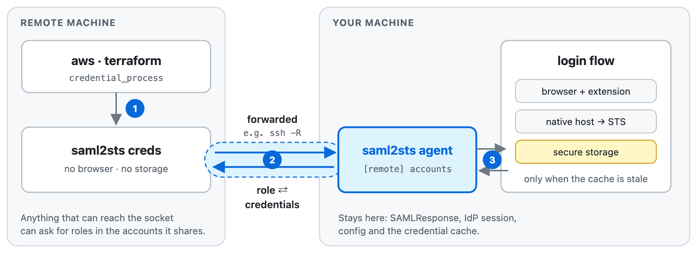

# Agent for work machines

Status: proposed. The client side is in place: `creds`, `exec` and `roles` ask the socket in `$SAML2STS_AGENT_SOCK`, always on Linux and on a Mac when the variable is set; see [installing on a Linux work machine](install.md#on-a-linux-work-machine). `saml2sts agent` itself is not implemented yet.

Use saml2sts on a [work machine that is not the sign-in machine](../README.md#sign-in-machine-and-work-machine), such as an SSH host, WSL, a local VM or a devcontainer, by forwarding the socket of an agent on the sign-in machine to it.

<picture>
  <source media="(prefers-color-scheme: dark)" srcset="images/agent-dark.png">
  
</picture>

## Model

It follows the [ghtkn agent](https://github.com/suzuki-shunsuke/ghtkn/blob/main/docs/agent-deployment.md):

- `saml2sts agent` runs on the sign-in machine and listens on a Unix domain socket. `saml2sts creds` on the work machine talks to that socket, wherever `$SAML2STS_AGENT_SOCK` points.
- Only role ARNs and short-lived STS credentials cross the socket. The SAML response, the IdP session, the config and the credential cache stay on the sign-in machine.
- The trust boundary is the socket's permissions and the way it is forwarded. Any process that can reach the socket, including root on the work machine, can ask for any role in the AWS accounts the agent shares.
- The agent shares no account until the config file names it, so production accounts can stay off shared hosts:

  ```toml
  [remote]
  accounts = ["222222222222"]
  ```
- Getting new credentials opens the browser on the sign-in machine, which tells you it happened. It is a notice, not a gate: a live IdP session completes the sign-in without you.

## Forwarding the socket

saml2sts does not forward the socket itself; anything that carries a Unix domain socket will do, as long as nothing on the way can read or alter the traffic and only the intended side can reach the socket. For example:

- `ssh -R /work/agent.sock:/sign-in/agent.sock`, the same mechanism as ssh-agent forwarding.
- A bind mount into a container on a Linux host, which never leaves the kernel.
- An SSH forward into the VM of colima or a similar runtime, since macOS cannot bind mount a socket into a container.

Do not bridge the socket onto a network port, for example with `socat`, without encryption and authentication.

## Not planned yet

- Peer authentication between the client and the agent. It is worth it only for transports that cannot meet the conditions above, such as a network port.
- Approval with Touch ID before new credentials are issued. It would be a separate feature covering every work machine alike.

## Open questions

- How the agent runs: started by hand, or kept alive by launchd.
- Devcontainers: document a bind mount of the forwarded socket, or support SSH hosts only.
- The wire format: newline-delimited JSON with a protocol version.
